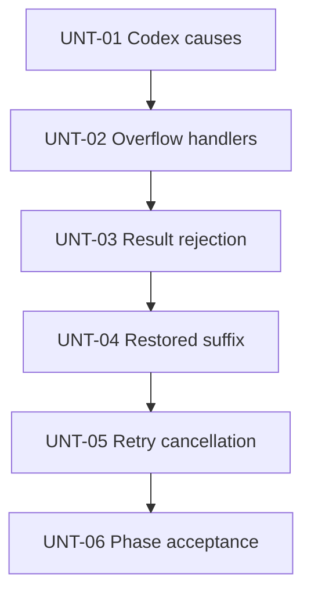

# Delivery Plan: PHS-06 acceptance corrections

Deliver the five confirmed scenarios and a whole-phase acceptance record within the [target boundaries](target-picture.md).

## Key definitions and abbreviations

Use existing [phase definitions](../ticket.md#key-definitions-and-abbreviations). Unit status values are pending, in progress, ready for review, reviewed, and complete. Ready for review means the author has supplied evidence and frozen the documentation for independent review. Complete means all exit criteria have evidence, independent review is accepted, and the local commit exists.

## Delivery Strategy

Use the [technical solution](technical-solution.md). Implement sequentially in the user checkout, preserving unrelated work. No rollout flag, storage migration, or dependency change is required. Create local commits only during implementation; do not push.

## Main Changes

Two production corrections preserve Codex failure causes and enabled retry-handler participation. Three evidence additions establish bundled result rejection, ordered restored suffix, and installed-wait cancellation. Whole-phase acceptance and linked status updates follow verified implementation.

## Entities and Invariants

See [existing data and ownership](technical-solution.md#existing-data-and-ownership), [Codex continuation](technical-solution.md#codex-refusal-only-continuation), and [retry admission](technical-solution.md#retry-handlers-before-ownerless-overflow-admission).

## New Folders and Components

No production component is introduced. This task directory contains delivery records; focused test files may be added beside existing tests.

## Backward Compatibility

No backward compatibility.

## Plan Units

| Unit | Performer | Independent checks | Status |
| --- | --- | --- | --- |
| UNT-01 | SubAgentCoderRegular | All four applicable repository reviews approved | complete, `7f10ace03153388cc66705b42121e3c0e2587f1d` |
| UNT-02 | SubAgentCoderRegular | Original and follow-up sets of four applicable reviews approved | complete, original `da9455f9afa4832acb29972c468cb1f0d92b0748`, corrective `5375876f770dc3eb4a7b4010bea472ff55a31539` |
| UNT-03 | SubAgentCoderRegular | All four applicable repository reviews approved | complete, `e18ee60b5c229ebf24c48834adae010ebfc1b24e` |
| UNT-04 | SubAgentCoderRegular | All four applicable repository reviews approved | complete, `d769d3004619c7b31d2669d49642ea78d75011eb` |
| UNT-05 | SubAgentCoderRegular | All four applicable repository reviews approved | complete, `4ac49d0bc9e7f97146eb0061886b7fb3e3a25726` |
| UNT-06 | Delivery owner | Final acceptance-conclusion and text reviews approved; both Minor text findings resolved | complete, `e7dd665cfc2dd50ab00182ad5be188dbe5619d27` |

### Unit Tree

### Decomposition Justification

Each code unit covers one observable behavior through an existing entry point and its relevant assertions. Every unit has its own verification and runs the complete mandatory check set before the next unit. Public assembly provides in-process verification for UNT-01 through UNT-04. UNT-05 uses the existing model-execution entry point under deterministic scheduling and retains public lifecycle observations. It adds no test-only production endpoint or temporary abstraction. UNT-06 records the aggregate acceptance result and updates status; it is a coordination/documentation task rather than another behavior implementation.

## Overengineering and Overspecification Considerations

All five code units map directly to FRQ-01 through FRQ-05. The aggregate acceptance unit serves NRQ-01. No prefactoring, compatibility layer, benchmark, generic fixture platform, or dependency change is planned. Private helper names and focused test-file placement remain implementation choices within the approved design.

### Unit UNT-01 - SLICE: Complete Codex refusal diagnostics

#### Goal

Meet FRQ-01 and A1 with complete refusal/read causes and preserved terminal behavior.

#### Behavior

An ordinary or configured-model caller receives a structured Codex refusal and any subsequently acquired stream failure, with refusal-based classification and the existing retry allowance.

#### Work

Apply the [Codex design](technical-solution.md#codex-refusal-only-continuation). Investigated locations include Codex provider.go and assembler.go; failure_test.go, stream_cleanup_integration_test.go, received_diagnostics_integration_test.go; and the public terminal_failure_modes_integration_test.go plus its existing client/extension helpers. Keep SDK iteration inside the concrete adapter and existing public mappings unchanged.

#### Verification

Own verification through real application assembly for ordinary and configured-model failure reporting, plus concrete driver tests for continuation and immediate-exit distinctions. Capture compiling RED/GREEN for refusal plus later read failure before changing production behavior. Assert provider explanation, independent read/close/delivery causes where applicable, category, attempt count, and owning cancellation. Reuse the existing public client fixture with narrow Codex refusal scenarios rather than expanding the full client/provider Cartesian product.

#### Exit criteria

A1 passes. Successful terminals, assembler-only errors, and delivery errors preserve immediate exits. Refusal-plus-conversion and cancellation branches retain all acquired causes. The shared readiness checks below pass under only the accepted vulnerability exception. Independent behavior and code-quality reviews have no unresolved accepted finding. Temporary probes/mutations are absent from the user checkout. A local commit records this unit.

#### Relation

First unit. Later terminal-fixture work in UNT-02 may use its completed test helper changes; no concurrent writers.

#### Risks

HIGH: continued reads could delay existing terminal exits or discard the original refusal. Driver-specific exit tests and public cause/category/count regressions cover those distinctions.

### Unit UNT-02 - SLICE: Enabled handlers for ownerless overflow

#### Goal

Meet FRQ-02 and A2 without admitting unchanged overflow repeats.

#### Behavior

Enabled handlers receive ordinary no-owner and configured-model context overflow and control terminal outcomes before Host enforces recovery availability.

#### Work

Apply the [retry admission design](technical-solution.md#retry-handlers-before-ownerless-overflow-admission). Investigated locations include modelexecution/retry.go, service.go, optional_policy_test.go, retry_handler_test.go, context_preparation_test.go; public terminal/retry acceptance fixtures; and external extension retry_handler.go. Reuse existing generated interfaces and fixture registration.

#### Verification

Own in-process public verification for ordinary and configured-model calls, complemented by model-execution mocks for ordered-chain assertions. Capture compiling RED/GREEN for skipped terminal handler outcomes. Cover Cancel, handler error, invalid action, Preserve, and a valid repeat override with no recovery. Assert complete causes, category, accepted Original/Current values, no later handlers for terminal actions, and one provider attempt. Preserve disabled-retry and captured-owner recovery regressions.

#### Exit criteria

A2 and the negative repeat-admission assertions pass. The shared readiness checks and separate behavior/code-quality reviews pass. No new public action or provider coupling remains. A local commit records this unit. The supplementary lint configuration later exposed three diagnostics in this delivery's ownerless-overflow test. Correct them in a separately reviewed follow-up commit before phase acceptance; retain the 18 diagnostics in unchanged-task files as report-only. This follow-up changes test style only and preserves the original RED/GREEN record.

#### Relation

Sequential after UNT-01 because both can touch public failure fixtures and share the verification environment.

#### Risks

HIGH: moving admission could permit nil recovery or an unchanged repeat. One-attempt and no-progress assertions plus captured-owner regressions cover the guard boundary.

### Unit UNT-03 - SLICE: Bundled result-rejection evidence

#### Goal

Meet FRQ-03 and A3 through bundled ownership.

#### Behavior

Bundled result-composition rejection preserves accepted state, complete causes, stopped participation, and absence of attempted or durable mutation.

#### Work

Apply the [bundled observation design](technical-solution.md#bundled-result-rejection-observations). Investigated locations include bundled policy/service.go and its generated mock tests; public manual_result_terminal_integration_test.go and standard_compaction_composition_integration_test.go; and reference result.go/result_terminal.go participant fixtures. Keep the reference coordinator's behavior unchanged.

#### Verification

Own in-process public assertions and bundled coordinator entry-point assertions. Exercise rejected action shape, boundary, ordinary failure, and cancellation-containing error separately from explicit Cancel. Require complete entry equality, absent receipt, accepted state, complete causes, no later-handler artifact, and no Commit mock invocation. In isolated copies, demonstrate sensitivity to installing rejected state, continuing after error, and attempting commit after rejection. These are evidence controls, not original RED chronology.

#### Exit criteria

A3 assertions and sensitivity controls have recorded results. No production change is presumed. If execution reveals a production defect, return to the appropriate design/plan stage before fixing it. Shared readiness checks and independent behavior/code-quality reviews pass. A local commit records this unit.

#### Relation

Sequential after UNT-02. Shared app fixtures and whole-project checks prohibit concurrent mutation.

#### Risks

MEDIUM: durable no-mutation alone could miss an attempted rejected commit. Coordinator mock expectations supply the complementary observation.

### Unit UNT-04 - SLICE: Ordered suffix after restoration

#### Goal

Meet FRQ-04 and A4 with an independent positive comparison.

#### Behavior

After two compactions and owner recreation, the next provider input preserves the latest summary and the entire selected suffix in order.

#### Work

Apply the [restoration design](technical-solution.md#ordered-restored-suffix). Investigated locations include standard_compaction_history_public_integration_test.go and its branch fixture; sessions/entry_history.go; and Codex history serialization. Expected data comes from saved fixture entries and the second receipt, not production projection helpers.

#### Verification

Own in-process verification in the existing summarized-span and default-installed restart cases, retaining the existing retained-span and navigation observations. Compare decoded model input with the complete expected retained sequence and newly submitted request. Ensure at least two distinct retained items make ordering observable. Demonstrate omission and reordering sensitivity in isolated copies.

#### Exit criteria

A4 positive comparisons and sensitivity controls pass. Original entry preservation and existing summary/prefix exclusion checks remain. Shared readiness checks and independent behavior/code-quality reviews pass. A local commit records this unit.

#### Relation

Sequential after UNT-03 because the units share app fixtures and check resources.

#### Risks

MEDIUM: using the first receipt or production projection as the oracle could validate the wrong suffix. Review the independent saved-entry/second-receipt derivation and mutation sensitivity.

### Unit UNT-05 - SLICE: Installed retry-wait cancellation

#### Goal

Meet FRQ-05 and A5 without a production acknowledgement API.

#### Behavior

Owning cancellation interrupts an installed retry wait, preserves provider and cancellation causes, and permits public lifecycle recovery.

#### Work

Apply the [deterministic cancellation design](technical-solution.md#deterministic-installed-wait-cancellation). Investigated locations include modelexecution/retry_cancellation_test.go, retry_test.go, and retry.go; existing public abort_idle integration tests remain the lifecycle evidence.

#### Verification

Own entry-point verification under synctest, with a worker durably blocked after progress returns, unchanged fake time before cancellation, no completed response before cancellation, complete causes, empty terminal response, and no second provider attempt. Retain public terminal ordering, idle, and retained-connection recovery observations. Demonstrate sensitivity to ignoring cancellation during the wait in an isolated production-source copy.

#### Exit criteria

Deterministic installed-wait evidence and public lifecycle regressions pass. No wall-clock sleep or test-only production seam remains. Shared readiness checks and independent behavior/code-quality reviews pass. A local commit records this unit.

#### Relation

Sequential after UNT-04 and dependent on completed UNT-02 retry changes.

#### Risks

MEDIUM: canceling from the progress callback would repeat the old evidence boundary. Independent review checks the actual worker synchronization and fake clock.

### Unit UNT-06 - OTHER TASK: Whole-phase acceptance and status closure

#### Goal

Meet NRQ-01 with an independently supported 40-clause conclusion and consistent project status.

#### Work

Reassess the existing acceptance inventory against the corrected revision, preserve historical per-unit evidence, and update the phase report, ticket, solution status, migration plan, roadmap, and linked prepared-history issue documents/index as their status requires. Record new verification commands, RED/GREEN chronology, sensitivity controls, exact skips, exceptions, review findings, and decisions in this task directory. Link to existing requirements rather than duplicating them.

#### Verification

Repeat mandatory whole-project checks on the assembled result, build, run generation twice with source identity checks, collect uncached integration test events and skip names, and validate changed documentation links/anchors and whitespace. SubAgentAnalyst independently reviews the whole-phase acceptance conclusion and 40-clause inventory. A separate SubAgentAnalyst reviews changed documentation text.

#### Exit criteria

All five correction units are complete. Independent acceptance identifies no unresolved required correction. Every phase clause has an evidence result. Existing skips and accepted debt remain explicit. Statuses match actual acceptance, local commits contain only authorized changes, and no push occurred. User review remains the next workflow stage.

#### Relation

Depends on UNT-01 through UNT-05. No phase completion status is asserted before their evidence exists.

#### Risks

HIGH: passing commands could conceal a missing condition or broaden historical evidence. Independent condition-by-condition review checks the actual assertions and evidence limits.

## Test Strategy

Each code unit runs task fmt, task fix_dry_run, task lint, task test, task itest, task test-coverage, and task build before submission. Analyze fix_dry_run output and apply only necessary corrections. Record task lint's actual exit under the specific accepted GO-2026-6809 exception, and execute external-plugin lint separately using the root-resolved tool if the main task stops before it. Do not suppress the scanner or change dependencies.

Use child TMPDIR=/var/tmp for full checks to preserve Unix socket path capacity and disk space. Keep raw commands, exit codes, outputs, source revision/manifests, and correction-specific observations. Final verification adds uncached integration test-event inventory and generation stability. Existing platform skips remain named evidence limits, not executed scenarios.

## Dependencies and Resourcing

Use declared Go, SDK, backoff, testify, and mockgen dependencies and existing application/extension fixtures. Coder units run sequentially. Independent read-only reviewers may run concurrently after a unit stops editing. No dependency installation or modification is authorized.

## Project Definition of Done

All local requirements and confirmed scenarios have evidence; all 40 parent/standard/prepared-history clauses are reassessed; independent reviews are resolved; full checks satisfy the project rules within the existing vulnerability exception; generated files are stable; documentation and status links are consistent; and the result is ready for final user acceptance.

## Assumptions

No unverified product assumption determines the unit list. Runtime regressions and assertion controls are exit evidence obligations, rather than conditional permission to change uninvestigated behavior.

## Open Questions

No unresolved implementation decision blocks execution. New findings outside the confirmed boundaries require the deviation procedure. Original F17 remains excluded throughout.

## Standards Deviations

No new deviation is accepted. Preserve the existing GO-2026-6809 scanner exception and previously accepted original test-first/evidence boundaries. Intermediate stages passed without user confirmation under final_only; final user acceptance remains required.

## References

- [Technical solution](technical-solution.md): mechanisms and dry-run branches.
- [Requirements](requirements.md): FRQ-01 through FRQ-05 and NRQ-01.
- [Decisions](decisions.md): autonomous choices D1 through D8.
- [UNT-06 evidence](unt-06-evidence.md): assembled verification, correction requirements, documentation validation and handoff limits.
- [Baseline](baseline.md): starting checks and environment correction.
