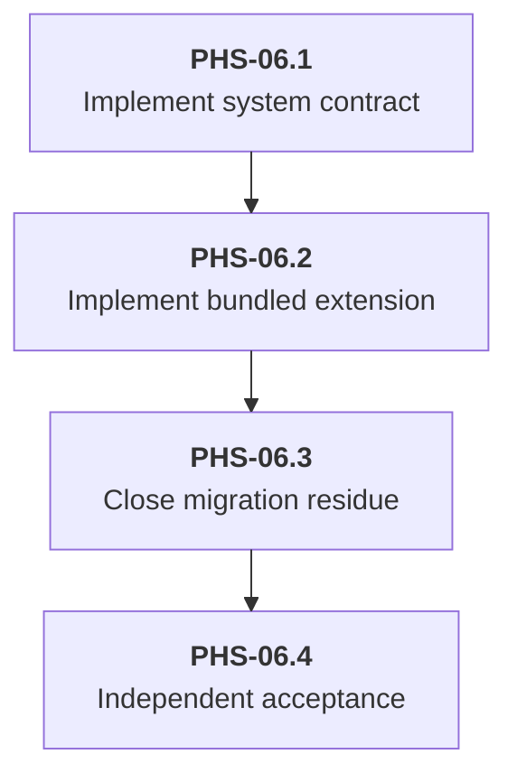

# Delivery Plan: PHS-06 extension-owned compaction migration

Status: PHS-06.1 system implementation is in progress. The approved system contracts passed the [scoped dry run](solution.md#phs-061-system-contract-dry-run-evidence). PHS-06.1 includes caller migration, Host-policy removal, and public-entry acceptance with a reference extension. The standard bundled extension and [QST-01.1](solution.md#qst-011-standard-summary-input-above-the-model-budget) belong to PHS-06.2.

Move compaction policy and composition from Host into an extension while retaining the durable history-replacement mechanism. Implementation starts from the restored `96f061c` baseline; checkpoint `690827f` remains comparison evidence. The old implementation order in the [checkpoint design](solution.md#unaccepted-checkpoint-design) is not the migration plan.

## Key definitions and abbreviations

- Compaction policy: decisions about triggering, sizing, retained boundaries, generation, and compaction-specific overflow handling.
- Compaction composition: ordered request/result transformations with immutable original values and composed current values.
- Prepared history: the model-facing history after session projection, including the latest applicable replacement entry and its retained suffix.
- Checkpoint: commit `690827f`, which preserves the unaccepted Host-owned implementation and the approved ownership requirements.

The [ticket](ticket.md#key-definitions-and-abbreviations) owns the detailed definitions and requirements.

## Delivery Strategy

### Resume point

- The restored working baseline is `96f061c` with the retained dependency updates and TUI test correction. Formatting, fix dry-run, lint, unit tests, integration tests, coverage, build, and diff checks passed. Coverage was 82.7%. These checks establish the starting state; phase acceptance requires the public behaviors below.
- Units 0 through 3 and the session-entry/projection foundation are implemented. The Host-owned unit 4 implementation is unaccepted. The bundled compaction extension is not implemented.
- PHS-06.1 has an approved [system integration design](solution.md#proposed-solution). Complete its system implementation and public-entry acceptance before PHS-06.2 implements the standard bundled policy and generator.
- After each completed migration phase, record its result, evidence, remaining blockers, and commit in this plan. The first phase without completed exit criteria is the resume point.

### Work boundaries

Preserve the approved [target ownership](solution.md#target-ownership) and the ticket's composition behavior. This work does not redesign ordinary retries, providers, tools, or branch summarization. The [production panic elimination issue](../../../../issues/production-panic-elimination/ticket.md) remains a separate task; this migration is not its remediation pass.

Retain the checkpoint's [open findings and accepted narrow test-first deviation](solution.md#implementation-evidence) as evidence, not as target behavior. Resolve the result-candidate and coherent-snapshot defects in the target paths that replace those responsibilities. Remove obsolete paths instead of repairing them solely to preserve the rejected architecture.

## Main Changes

- Move trigger decisions, sizing and usage-baseline policy, retained-boundary selection, request/result composition, summary generation, and compaction-specific overflow decisions into the extension.
- Connect manual commands, pre-request preparation, and overflow handling to that policy through the minimal agreed integration contract.
- Keep session-bound access, structural validation, atomic history mutation, projection, publication, and accounting with their Host/session owners.
- Delete superseded Host policy and its obsolete contracts in the migration, without a forwarding layer or fallback implementation.

## Entities and Invariants

- A replacement entry changes model-visible context, not stored original history. Repeated compaction, restart, navigation, fork, and clone retain the ticket's projection behavior.
- Session identity, active-branch membership, source accounting, and tool-call/result integrity remain mutation invariants enforced by the session owner.
- Agent Core receives prepared history and has no compaction policy or compaction-specific orchestration.
- Ordered composition, generation bypass for a supplied result, explicit cancellation, complete error causes, and committed outcomes remain observable behavior.
- Ordinary retry allowance and completed-tool execution are preserved. Compaction-specific recovery must not create an independent retry budget.

The [ticket requirements and acceptance criteria](ticket.md#requirements) define these invariants; this plan does not add another policy specification.

## New Folders and Components

The bundled compaction extension is the required runtime addition. The [technical solution](solution.md#host-placement-and-dependency-direction) defines Host integration placement and the minimal system contract. Bundled-extension package design belongs to PHS-06.2. No new Host compaction-policy service, shared-contract namespace, or general middleware platform is planned.

The checkpoint's [Host compaction implementation](../../../../../../host/internal/usecase/host/contextcompaction), [model execution](../../../../../../host/internal/usecase/host/modelexecution), [session owner](../../../../../../host/internal/usecase/host/sessions), and [Extension SDK](../../../../../../sdk/plugins/extension/v1) are the starting points for the ownership map. Their present API shapes do not constrain the target contract.

## Backward Compatibility

No backward compatibility. Replace affected internal and public contracts with their callers in the same migration. The [behavior-slice migration](#decomposition-justification) retains the old mechanism only for behaviors that later slices move. No alias, forwarding facade, or fallback generator preserves a superseded caller.

## Phased Plan

### Phase Tree

The phases are sequential. Their identifiers are subphases of product phase PHS-06.

### Decomposition Justification

Each PHS-06.1 slice delivers one observable behavior through its public entry point. Configured-model image input, connection failure, and runtime shutdown have independent callers and checks. Later slices use those completed behaviors. Protocol declarations, SDK support, adapters, and fixtures arrive in the first slice that needs them. A reference extension verifies each system behavior independently of the standard bundled algorithm.

During migration, `contextcompaction` serves only behaviors assigned to later slices. For example, after manual replacement moves to the policy extension, automatic preparation and overflow still use their existing paths until UNT-09 and UNT-10. Their internal usage state remains only while those paths consume it. A migrated behavior has one owner and no fallback to the old path. Each slice removes its superseded calls; UNT-11 removes the remaining package and shared residue.

Tests exercise history changes and public operation outcomes. There are no tests whose only purpose is to count new types, assert deleted functionality is absent, or compare mutable prompts.

## Overengineering and Overspecification Considerations

Reuse session history and extension runtime mechanisms. Determine only the integration needed by the approved manual, automatic, and overflow paths. Do not invent API names, additional components, feature flags, or a generic framework before PHS-06.1 establishes a concrete need.

### Phase PHS-06.1 - Implement the extension-owned compaction system contract

Status: In progress. System-contract design and its scoped dry run are complete. System implementation, caller migration, Host-policy removal, and public-entry acceptance remain pending. The standard bundled algorithm and QST-01.1 are excluded from this phase.

#### Goal

Provide the complete system path through which a registered policy extension controls compaction without a Host compaction policy.

#### Work

Follow the [approved system integration](solution.md#phs-061-integration-proposal) through the sequential units below. Each unit includes its callers and public-entry checks. Use a real reference extension for system acceptance. The standard bundled policy and generator belong to PHS-06.2.

#### Sequential implementation units

UNT-01 through UNT-10 are behavior slices. UNT-11 is Cleanup. Every unit starts only after the previous unit passes the [completion checks](#unit-completion-and-review). UNT-01 passed full checks and independent review and is committed as `5165a14`. UNT-02 passed the same gates and is committed as `bf62186`. UNT-03 passed project checks and independent review and is committed as `23f2f55`. The [runtime shutdown evidence](solution.md#tracked-runtime-shutdown) records its completion paths. Implementation is paused before UNT-04; UNT-04 through UNT-11 are planned.

| Unit | Observable result and public-entry check | Executor role |
|---|---|---|
| UNT-01: Configured-model image input | An extension sends ordered text/image user content through the public SDK to the provider adapter. Tests check exact image bytes, ordering, invalid input, explicit selection, and conversation isolation. The Codex adapter sends the caller's instruction string, including an empty string, and preserves complete provider error causes. | `SubAgentCoderRegular` |
| UNT-02: Connection failure without transport waiting | A handler can report connection failure and return while transport shutdown is pending. The connection owner later waits for resource cleanup and receives all acquired failure causes. Tests exercise both completion points through the SDK connection. | `SubAgentCoderRegular` |
| UNT-03: Tracked runtime shutdown | The manager closes failed-runtime admission and independently tracks shutdown. A worker can finish without waiting for itself; application close joins shutdown and retains cleanup errors. Tests exercise protocol failure, cancellation, and completion. | `SubAgentCoderComplex` |
| UNT-04: Manual replacement from a complete policy result | UI, Programmatic, and Extension calls invoke the registered policy owner. The owner receives one snapshot and can request a validated durable replacement. Tests cover the next model request, preserved original history, changed-branch rejection, cancellation, committed failure diagnostics, and an explicit error when no owner exists. | `SubAgentCoderComplex` |
| UNT-05: Request-handler invocation | The policy extension invokes registered request handlers through operation-bound Host calls. A reference extension demonstrates registration order, immutable original input, independent request/result changes, cancellation, and terminal failure. Host routes one invocation at a time as requested by the extension. | `SubAgentCoderRegular` |
| UNT-06: Generator invocation | The policy extension invokes its selected generator, which can use configured-model access. Tests cover a generator in the policy runtime, images, cancellation, conversation isolation, and generation bypass for a complete supplied result. | `SubAgentCoderRegular` |
| UNT-07: Result-handler invocation | The policy extension invokes result handlers and validates each candidate before accepting its next state. Tests cover ordered changes, immutable original result, rejected candidates, and retention of the last accepted state. | `SubAgentCoderRegular` |
| UNT-08: Completed-conversation observation | The captured policy owner receives the actual successful attempt input and response before logical success. Tests cover observer failure with preserved response/usage/causes, a rebuilt overflow input, and exclusion of nested generator requests from conversation observations. | `SubAgentCoderRegular` |
| UNT-09: Automatic preparation | Before provider dispatch, Host invokes the captured policy owner to preserve or replace context. Tests check actual outgoing input after commit notifications and retention of the captured owner. With no registered owner, the ordinary request proceeds without automatic compaction. | `SubAgentCoderComplex` |
| UNT-10: Overflow recovery | Host reports provider overflow to the captured owner within its admitted retry path. Tests check rebuilt input, the original attempt allowance, completed-tool preservation, cancellation, committed failures, and absence of compaction recovery when no owner exists. | `SubAgentCoderRegular` |
| UNT-11: Cleanup | Remove `contextcompaction`, remaining obsolete contracts, settings, and assembly connections. Retain session projection and ordinary retries. Update phase documentation and run the complete acceptance checks against the single target implementation. | `SubAgentCoderRegular` |

#### Dependencies and instance allocation

UNT-03 depends on UNT-02. UNT-04 depends on both lifecycle units. UNT-05 through UNT-07 extend the accepted manual path, and UNT-06 also uses UNT-01 image input. UNT-08 through UNT-10 add observation, automatic preparation, and overflow recovery in order. UNT-11 follows all migrated behaviors.

Each unit has a fresh executor session with the role listed above. Complex executors own runtime lifetime, manual operation snapshots, and captured automatic preparation. Regular executors implement the bounded paths whose ownership and contracts are already defined. Units run sequentially because they share code and project checks.

#### Unit completion and review

Each behavior change has fresh compiling RED/GREEN evidence and a check through the highest available public entry point. All units pass formatting, fix dry-run analysis, lint, unit tests, integration tests, coverage, build, package loading, and diff checks. Changes to generated inputs also pass repeated stable generation. Temporary stubs and debugging code are removed before acceptance.

After each unit and each migration phase, a fresh `CodeQuality` session reviews the completed changes in correction mode before acceptance and commit. The agent applies behavior-preserving corrections within its role and reports findings that need behavior, public-contract, or architecture changes for a separate decision. Main checks the findings and corrections against primary source and repeats completion checks after code corrections. At UNT-11, the same pass covers both the Cleanup unit and the complete PHS-06.1 change set.

After the quality pass, a fresh `SubAgentAnalyst` session independently reviews each completed unit. Main checks review claims against primary source, resolves accepted findings, and repeats completion checks after code corrections. Main then makes one local commit for the accepted unit, excluding pre-existing edits. Corrections to committed units receive separate corrective commits. Subagents do not commit, and no remote ref changes are part of this plan.

After the UNT-11 quality pass and unit review, a fresh `SubAgentExtractor` session repeats final checks. A fresh `SubAgentCritic` session examines the completed result. Main owns acceptance reporting. These checks do not replace per-unit verification or the broader PHS-06.4 acceptance of the future bundled extension.

#### Deliverables

The system contract verified by a reference extension, migrated operation paths, removal of replaced Host policy, and uncached behavioral/integration evidence.

#### Exit criteria

A reference extension works through real public entry points. Manual, automatic, and overflow paths use the captured extension-owned policy. Without a registered owner, ordinary requests proceed without compaction and manual compaction fails explicitly. Original history remains durable and model requests use the replacement summary plus retained suffix. Required composition and custom complete replacement work through public contracts. Host and Agent Core do not execute an alternate compaction algorithm.

#### Risks

Mocked capability fixtures can conceal an unwired real extension. Include production runtime, SDK, session, and model-execution paths rather than treating mock-backed transport tests as full assembly evidence.

### Phase PHS-06.2 - Implement the standard bundled compaction extension

Status: Planned. Depends on PHS-06.1 system acceptance. QST-01.1 belongs to this phase's preparation.

#### Goal

Provide the standard coding agent with an enabled bundled policy and generator through the accepted public system contracts.

#### Work

- Resolve the standard oversized-summary and source-accounting strategy under QST-01.1.
- Implement standard triggering, sizing, usage-baseline policy, retained-boundary selection, ordered composition, summary preparation/generation, and overflow decisions in the bundled extension.
- Supply extension-local retained-history configuration and the approved default, with independent generator registration control.
- Verify standard and custom composition through the accepted system path, including preceding summaries and image input.

#### Deliverables

The standard bundled policy and generator with extension-local configuration and behavioral evidence.

#### Exit criteria

The standard coding-agent assembly enables the bundled extension. The ticket's standard-policy and default-generation acceptance criteria pass without adding a Host compaction algorithm.

#### Risks

The standard algorithm must use the accepted system services. Algorithm decisions must not reintroduce Host policy.

### Phase PHS-06.3 - Close migration residue and documentation

#### Goal

Leave one target implementation and documentation that describes it.

#### Work

- Inspect the migrated call graph for obsolete Host policy, unused contracts, duplicate estimators, forwarding wrappers, and compatibility aliases. Remove residue not already removed with its callers.
- Regenerate public contracts and mocks. Correct the projected-session-entry description and other contract comments whose scope changed.
- Update the technical solution and phase status to separate target behavior from checkpoint evidence. Keep unresolved findings open instead of marking the phase complete because checks pass.
- Run the project's mandatory generation, formatting, fix, lint, unit, integration, coverage, build, package, and diff checks.

#### Deliverables

One implementation path, matching generated artifacts, accurate documentation, and full verification results.

#### Exit criteria

No superseded Host policy or compatibility path remains. Generation is stable on the second run. Required checks pass. Tests and documentation refer to the target boundary, and the working changes are ready for independent review.

#### Risks

Cleanup can become unrelated refactoring. Limit it to migration residue; keep the separate panic issue outside this phase.

### Phase PHS-06.4 - Independent acceptance

#### Goal

Accept PHS-06 against the approved requirements and actual user-facing behavior.

#### Work

- Independently review the complete migration diff against checkpoint `690827f`, the ticket, and the target technical solution.
- Exercise the bundled extension and a custom complete replacement through real public boundaries. Cover manual, automatic, overflow, repeated compaction, restart/navigation, cancellation, and post-commit failures.
- Distinguish production assembly evidence from mocked ports and report platform skips explicitly. Reject unsupported findings by checking the actual path and its called helpers.
- Correct supported defects with test-first evidence and repeat the complete review. Record the accepted result and commit before marking PHS-06 complete.

#### Deliverables

Independent review results, assembled-path evidence, and an accurate phase-completion record.

#### Exit criteria

All ticket acceptance criteria have executable evidence. No unapproved blocker or major finding remains. The full verification suite passes and the roadmap reflects completed target behavior rather than the checkpoint.

#### Risks

Earlier green checks did not prove correctness or architectural acceptance. Base closure on the implemented ownership and observable outcomes as well as command results.

## Test Strategy

Use compiling uncached RED/GREEN for behavior changes. Behavior-preserving moves and documentation changes do not require artificial RED evidence. Preserve session/projection regression coverage and add boundary tests for coherent snapshots, validated candidate installation, cancellation ownership, and committed outcomes where the target implementation needs them.

Use integration-tagged tests for assembled production components and real filesystem, process, transport, or terminal paths. Do not test logs or prompt wording. Compare generation twice and complete the mandatory project checks before implementation acceptance. The accepted checkpoint TDD exception is historical and does not waive test-first work in this migration.

## Dependencies and Resourcing

PHS-07 and PHS-04.1 are the ticket dependencies. PHS-06.1 system-contract design is complete. PHS-06.2 preparation still requires QST-01.1 and separate implementation authorization; the old generator-only unit 5 is not the continuation path. The plan assumes no new dependency, staffing, or external service.

## Project Definition of Done

The extension owns compaction policy and composition; session services preserve and project replacement entries; Agent Core consumes prepared history without compaction knowledge. All required public flows and composition behaviors pass their acceptance checks, replaced Host policy is removed, independent review is complete, and the solution and roadmap record the result.

## Assumptions

No additional product behavior or integration API is assumed. Checkpoint `690827f` is a comparison baseline, not an accepted target implementation.

## Open Questions

The system-contract [QST-01](ticket.md#qst-01-minimal-compaction-integration-contract) is resolved for PHS-06.1 system-contract design. System implementation continues through the units above. [QST-01.1](solution.md#qst-011-standard-summary-input-above-the-model-budget) remains an extension-implementation and source/accounting decision for PHS-06.2 preparation. This plan links to the owning question rather than selecting or duplicating its answer.

## Standards Deviations

No new deviation is authorized. The narrowly accepted checkpoint test-first deviation remains documented in [implementation evidence](solution.md#implementation-evidence) and is not migration evidence.

## References

- [PHS-06 ticket](ticket.md) - requirements, acceptance criteria, and QST-01.
- [Target solution](solution.md#proposed-solution) - approved ownership and pending integration design.
- [Checkpoint evidence](solution.md#implementation-evidence) - implemented units, open findings, and process exception.
- [Target architecture](../../architecture.md) - Agent Core, Host, extension, and session boundaries.
- [Product delivery plan](../../delivery-plan.md) and [roadmap](../../../../../roadmap.md) - product ordering and phase status.
