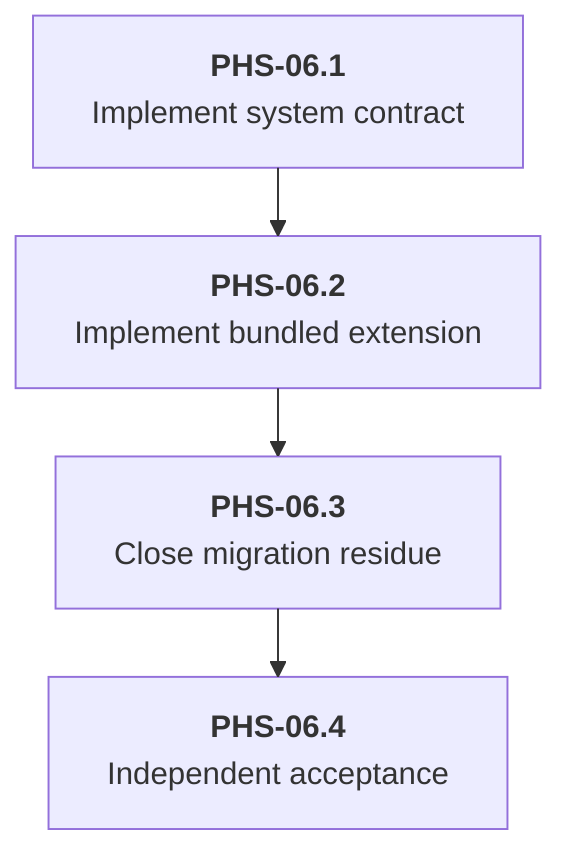

# Delivery Plan: PHS-06 extension-owned compaction migration

Status: PHS-06.1 is complete and accepted. PHS-06.2 has A1 accounting, A2 manual compaction, A3 automatic compaction, and A4 admitted overflow recovery implemented. PHS-06.3 residue closure is complete; PHS-06.4 implementation and independent acceptance-conclusion review are complete within the [recorded boundaries](acceptance-report.md). The phase is delivery-ready on implementation and acceptance evidence. Final text review is approved and UNT-06 is complete in documentation commit `e7dd665cfc2dd50ab00182ad5be188dbe5619d27`. Final user acceptance remains pending. See the [system acceptance record](system-integration-evidence.md), [unit progress](#sequential-implementation-units), [PHS-06.2 progress](#phase-phs-062---implement-the-standard-bundled-compaction-extension), and [PHS-06.3 closure record](residue-closure-evidence.md).

Move compaction policy and composition from Host into an extension while retaining the durable history-replacement mechanism. Implementation started from the restored `96f061c` baseline; checkpoint `690827f` remains comparison evidence. The old implementation order in the [checkpoint design](solution.md#unaccepted-checkpoint-design) is not the migration plan.

## Key definitions and abbreviations

- Compaction policy: decisions about triggering, sizing, retained boundaries, generation, and compaction-specific overflow handling.
- Compaction composition: ordered request/result transformations with immutable original values and composed current values.
- Prepared history: the model-facing history after session projection, including the latest applicable replacement entry and its retained suffix.
- Checkpoint: commit `690827f`, which preserves the unaccepted Host-owned implementation and the approved ownership requirements.

The [ticket](ticket.md#key-definitions-and-abbreviations) owns the detailed definitions and requirements.

## Delivery Strategy

### Resume point

- A1-A4 of [PHS-06.2](#phase-phs-062---implement-the-standard-bundled-compaction-extension) are implemented against the approved [requirements](phs-06.2_prd.md) and [technical solution](phs-06.2_solution.md). [PHS-06.3 residue closure](residue-closure-evidence.md) is complete. The [PHS-06.4 record](acceptance-report.md) reassesses all 40 clauses after five independently approved corrective units and the UNT-02 follow-up. Their commits are in the [correction plan](acceptance-corrections/plan.md#plan-units). Independent acceptance-conclusion review approves all 40 clauses and the correction requirements. Final text review is approved and UNT-06 is complete in documentation commit `e7dd665cfc2dd50ab00182ad5be188dbe5619d27`. Final user acceptance remains pending.
- The historical starting baseline was `96f061c`, with retained dependency updates and the TUI test correction. Formatting, fix dry-run, lint, unit tests, integration tests, coverage, build and diff checks passed at that point; coverage was 82.7%. The [system acceptance record](system-integration-evidence.md) contains the final PHS-06.1 results.
- Checkpoint units 0 through 3 and the session foundation preceded the migration. The checkpoint's Host-owned unit 4 was unaccepted. After migrating its callers, the UNT-11 implementer removed the remaining Host policy.
- After each completed migration phase, record its result, evidence, remaining blockers, and commit in this plan. The first phase without completed exit criteria is the resume point.

### Work boundaries

Preserve the approved [target ownership](solution.md#target-ownership) and the ticket's composition behavior. This work does not redesign ordinary retries, providers, tools, or branch summarization. The [production panic elimination issue](../../../../issues/production-panic-elimination/ticket.md) remains a separate task; this migration is not its remediation pass.

Retain the checkpoint's [open findings and accepted narrow test-first deviation](solution.md#implementation-evidence) as evidence, not as target behavior. Resolve the result-candidate and coherent-snapshot defects in the target paths that replace those responsibilities. Remove obsolete paths instead of repairing them solely to preserve the rejected architecture.

## Main Changes

- Move trigger decisions, sizing and usage-baseline policy, retained-boundary selection, request/result composition, summary generation, and compaction-specific overflow decisions into the extension.
- Connect manual commands, pre-request preparation, and overflow handling to that policy through the minimal agreed integration contract.
- Keep session-bound access, structural validation, atomic history mutation, projection, publication, and accounting with their Host/session owners.
- Delete superseded Host policy and its obsolete contracts in the migration, without a forwarding layer or fallback implementation.

## Entities and Invariants

- A replacement entry changes model-visible context, not stored original history. Repeated compaction, restart, navigation, fork, and clone retain the ticket's projection behavior.
- Session identity, active-branch membership, source accounting, and tool-call/result integrity remain mutation invariants enforced by the session owner.
- Agent Core receives prepared history and has no compaction policy or compaction-specific orchestration.
- Ordered composition, generation bypass for a supplied result, explicit cancellation, complete error causes, and committed outcomes remain observable behavior.
- Ordinary retry allowance and completed-tool execution are preserved. Compaction-specific recovery must not create an independent retry budget.

The [ticket requirements and acceptance criteria](ticket.md#requirements) define these invariants; this plan does not add another policy specification.

## New Folders and Components

The bundled compaction extension is the required runtime addition. The [technical solution](solution.md#host-placement-and-dependency-direction) defines Host integration placement and the minimal system contract. Bundled-extension package design belongs to PHS-06.2. No new Host compaction-policy service, shared-contract namespace, or general middleware platform is planned.

The checkpoint's Host policy source is `host/internal/usecase/host/contextcompaction` at commit `690827f6631a1197972e50c48b196ab462576bbd`. The live ownership map uses [extension integration](../../../../../../host/internal/usecase/host/extensioncontext), [model execution](../../../../../../host/internal/usecase/host/modelexecution), [session services](../../../../../../host/internal/usecase/host/sessions), and the [Extension SDK](../../../../../../sdk/plugins/extension/v1).

## Backward Compatibility

No backward compatibility. Replace affected internal and public contracts with their callers in the same migration. The [behavior-slice migration](#decomposition-justification) retains the old mechanism only for behaviors that later slices move. No alias, forwarding facade, or fallback generator preserves a superseded caller.

## Phased Plan

### Phase Tree

The phases are sequential. Their identifiers are subphases of product phase PHS-06.

### Decomposition Justification

Each PHS-06.1 slice delivers one observable behavior through its public entry point. Configured-model image input, connection failure, and runtime shutdown have independent callers and checks. Later slices use those completed behaviors. Protocol declarations, SDK support, adapters, and fixtures arrive in the first slice that needs them. A reference extension verifies each system behavior independently of the standard bundled algorithm.

During UNT-01 through UNT-10, `contextcompaction` served behaviors assigned to later slices. Automatic preparation and overflow moved to the extension owner in UNT-09 and UNT-10. Each migrated behavior has one owner. UNT-11 removes the remaining package and shared residue after those caller migrations.

Tests exercise history changes and public operation outcomes. There are no tests whose only purpose is to count new types, assert deleted functionality is absent, or compare mutable prompts.

## Overengineering and Overspecification Considerations

Reuse session history and extension runtime mechanisms. Determine only the integration needed by the approved manual, automatic, and overflow paths. Do not invent API names, additional components, feature flags, or a generic framework before PHS-06.1 establishes a concrete need.

### Phase PHS-06.1 - Implement the extension-owned compaction system contract

Status: Complete and accepted. The [system acceptance record](system-integration-evidence.md) contains final checks, independent reviews and limits. The [scoped dry run](solution.md#phs-061-system-contract-dry-run-evidence) records the earlier design evidence.

#### Goal

Provide the complete system path through which a registered policy extension controls compaction without a Host compaction policy.

#### Work

Follow the [approved system integration](solution.md#phs-061-integration-contract) through the sequential units below. Each unit includes its callers and public-entry checks. Use a real reference extension for system acceptance. This phase includes caller migration, Host-policy removal, and public-entry acceptance; PHS-06.2 owns the standard bundled policy and generator.

#### Sequential implementation units

UNT-01 through UNT-10 are behavior slices. UNT-11 is Cleanup. Every unit starts only after the previous unit passes the [completion checks](#unit-completion-and-review).

[UNT-11 cleanup](system-integration-evidence.md#cleanup-and-preservation) is accepted at `9555cda`. All eleven units are accepted with the [historical evidence limits](system-integration-evidence.md#remaining-limits-and-historical-failures). The fresh phase-wide verification repeat and independent Critic review are complete; the [acceptance record](system-integration-evidence.md#final-verification-and-reviews) retains their evidence and limits.

- Accepted units: UNT-01 (`5165a14`), UNT-02 (`bf62186`), UNT-03 (`23f2f55`), UNT-04 (`85f7b9a`), UNT-05 (`4181ae2`), UNT-06 (`87699e9`), UNT-07 (`d22e210`), UNT-08 (`fed40b6`), UNT-09 (`e4865d8`), UNT-10 (`904463b`), and UNT-11 (`9555cda`) passed full checks, code-quality review, and independent review. The [result-handler integration evidence](result-integration-evidence.md) describes UNT-07 behavior, final verification, and evidence limits. The [generator integration evidence](generator-integration-evidence.md) describes UNT-06 behavior, final verification, and evidence limits. The [request-handler integration evidence](request-integration-evidence.md) describes UNT-05 behavior, corrective RED/GREEN cycles, and evidence limits. See [configured-model input](solution.md#configured-model-image-input), [runtime shutdown](solution.md#tracked-runtime-shutdown), and [manual policy integration evidence](manual-integration-evidence.md) for behavior and checks. The [SDK connection failure tests](../../../../../../sdk/plugins/extension/v1/connection_failure_integration_test.go) and [Host-handler integration test](../../../../../../sdk/plugins/extension/v1/connection_handler_failure_integration_test.go) check failure reporting before shutdown and owner cleanup through `Close`.
- Retained baseline: `64bcecd`. Safe quality corrections: `1612ae5`.
- Accepted code corrections:
  - `2cf86e8`: shared configured-input image fixture construction and named configured-input protocol values.
  - `53f4c06`: single-owner runtime-unavailability classification with complete error causes.
  - `efdd9cf`: separate shutdown scenario helpers, removal of duplicate registration cleanup, and named shutdown modes and formatting templates.
  - `487fe8a`: request-handler result producer identity validation. The [correction evidence](request-integration-evidence.md#request-result-producer-identity-correction) describes public rejection, metadata preservation, and verification limits.
  - `aa7f0fd`: client send-EOF resolution in the Extension and UI Host clients.
  - `ac80f52`: guarded executable-fixture creation during concurrent forks. The [automatic integration evidence](automatic-integration-evidence.md#client-transport-and-fixture-corrections) describes both corrections and their checks.
  - `33163d6`: shared retry-progress and pending-delay cancellation diagnostics. The [overflow integration evidence](overflow-integration-evidence.md#shared-cancellation-correction) records the preserved provider causes and category regressions.
  - `4d720d9`: the [peer-close fixture correction](system-integration-evidence.md#peer-close-fixture-correction) orders the late request after mock Send observes Host Close, preserving all assertions.
  - All code corrections passed CodeQuality, full checks on the combined final source, and independent review.
- Document clarity and status corrections: linked progress and phase ordering, positive behavior statements, explicit component ownership, split design blocks and resumed-work status passed review. `10e1e49` records the later ownership and historical-evidence wording corrections. Local references, anchors and whitespace checks passed; these corrections changed no executable code.

| Unit | Observable result and public-entry check | Executor role |
|---|---|---|
| UNT-01: Configured-model image input | An extension sends ordered text/image user content through the public SDK to the provider adapter. Tests check exact image bytes, ordering, invalid input, explicit selection, and conversation isolation. The Codex adapter sends the caller's instruction string, including an empty string, and preserves complete provider error causes. | `SubAgentCoderRegular` |
| UNT-02: Connection failure without transport waiting | A handler can report connection failure and return while transport shutdown is pending. The connection owner later waits for resource cleanup and receives all acquired failure causes. Tests exercise both completion points through the SDK connection. | `SubAgentCoderRegular` |
| UNT-03: Tracked runtime shutdown | The manager closes failed-runtime admission and independently tracks shutdown. A worker can finish without waiting for itself; application close joins shutdown and retains cleanup errors. Tests exercise protocol failure, cancellation, and completion. | `SubAgentCoderComplex` |
| UNT-04: Manual replacement from a complete policy result | UI, Programmatic, and Extension calls invoke the registered policy owner. The owner receives one snapshot and can request a validated durable replacement. Tests cover the next model request, preserved original history, changed-branch rejection, cancellation, committed failure diagnostics, and an explicit error when no owner exists. | `SubAgentCoderComplex` |
| UNT-05: Request-handler invocation | The policy extension invokes registered request handlers through operation-bound Host calls. A reference extension demonstrates registration order, immutable original input, independent request/result changes, cancellation, and terminal failure. Host routes one invocation at a time as requested by the extension. | `SubAgentCoderRegular` |
| UNT-06: Generator invocation | The policy extension invokes its selected generator, which can use configured-model access. Tests cover a generator in the policy runtime, images, cancellation, conversation isolation, and generation bypass for a complete supplied result. | `SubAgentCoderRegular` |
| UNT-07: Result-handler invocation | The policy extension invokes result handlers and validates each candidate before accepting its next state. Tests cover ordered changes, immutable original result, rejected candidates, and retention of the last accepted state. | `SubAgentCoderRegular` |
| UNT-08: Completed-conversation observation | The captured policy owner receives the actual successful attempt input and response before logical success. Tests cover observer failure with preserved response/usage/causes, a rebuilt overflow input, and exclusion of nested generator requests from conversation observations. | `SubAgentCoderRegular` |
| UNT-09: Automatic preparation | Before provider dispatch, Host invokes the captured policy owner to preserve or replace context. Tests check actual outgoing input after commit notifications and retention of the captured owner. With no registered owner, the ordinary request proceeds without automatic compaction. | `SubAgentCoderComplex` |
| UNT-10: Overflow recovery | Host reports provider overflow to the captured owner within its admitted retry path. Tests check rebuilt input, the original attempt allowance, completed-tool preservation, cancellation, committed failures, and absence of compaction recovery when no owner exists. | `SubAgentCoderRegular` |
| UNT-11: Cleanup | Remove `contextcompaction`, remaining obsolete contracts, token-policy settings, and assembly connections. Retain Host participant-duration configuration, session projection, and ordinary retries. Update phase documentation and run the complete acceptance checks against the single target implementation. | `SubAgentCoderRegular` |

#### Dependencies and instance allocation

UNT-03 depends on UNT-02. UNT-04 depends on both lifecycle units. UNT-05 through UNT-07 extend the accepted manual path, and UNT-06 also uses UNT-01 image input. UNT-08 through UNT-10 add observation, automatic preparation, and overflow recovery in order. UNT-11 follows all migrated behaviors.

Each unit has a fresh executor session with the role listed above. Complex executors own runtime lifetime, manual operation snapshots, and captured automatic preparation. Regular executors implement the bounded paths whose ownership and contracts are already defined. Units run sequentially because they share code and project checks.

#### Unit completion and review

Each behavior change has fresh compiling RED/GREEN evidence and a check through the highest available public entry point. All units pass formatting, fix dry-run analysis, lint, unit tests, integration tests, coverage, build, package loading, and diff checks. Changes to generated inputs also pass repeated stable generation. Temporary stubs and debugging code are removed before acceptance.

After each unit and each migration phase, a fresh `SubAgentCodeQuality` session reviews the prepared changes in report-only mode before acceptance. Main is the coordinating assistant responsible for integration. Main checks findings against primary source and collects the correction batch. Main uses targeted checks during corrections and runs the full required verification once after the last correction and before commit. At UNT-11, the code review covers both the Cleanup unit and the complete PHS-06.1 change set.

After the code-quality review, a fresh `SubAgentTextQuality` session checks the changed documentation and comments in report-only mode. Main checks text findings against primary source and applies their adjudicated dispositions in the correction batch. A fresh `SubAgentAnalyst` session independently reviews each unit before acceptance. Main checks review claims against primary source and resolves accepted findings through the same correction and verification process. Main owns local commits, including verified intermediate checkpoints and separate later correction commits, excluding pre-existing edits. Subagents do not commit, and no remote ref changes are part of this plan.

After the UNT-11 quality pass and unit review, a fresh `SubAgentExtractor` session repeats final checks. A fresh `SubAgentCritic` session examines the completed result. The integration coordinator owns acceptance reporting. These checks do not replace per-unit verification or the broader PHS-06.4 acceptance of the future bundled extension.

#### Deliverables

The system contract verified by a reference extension, migrated operation paths, removal of replaced Host policy, and uncached behavioral/integration evidence.

#### Exit criteria

A reference extension works through real public entry points. Manual, automatic, and overflow paths use the captured extension-owned policy. Without a registered owner, ordinary requests proceed without compaction and manual compaction fails explicitly. Original history remains durable and model requests use the replacement summary plus retained suffix. Required composition and custom complete replacement work through public contracts. Host and Agent Core do not execute an alternate compaction algorithm.

#### Risks

Mocked capability fixtures can conceal an unwired real extension. Include production runtime, SDK, session, and model-execution paths rather than treating mock-backed transport tests as full assembly evidence.

### Phase PHS-06.2 - Implement the standard bundled compaction extension

Status: A1-A4 implemented. A1 implements [D6 per-request accounting](phs-06.2_solution.md#d6-per-request-accounting-for-persisted-compaction). A2 implements bundled manual compaction. A3 implements automatic preparation and conversation observations. In A4, the bundled compaction extension implements admitted overflow recovery through the standard composition path. [PHS-06.3 residue closure](residue-closure-evidence.md) is complete; PHS-06.4 acceptance-conclusion and final text reviews are approved, and the UNT-06 documentation commit exists. Final user acceptance remains pending.

Documents:
- [Problem statement](phs-06.2_problem.md)
- [Requirements](phs-06.2_prd.md)
- [Technical solution and design-validation outcome](phs-06.2_solution.md)

#### Goal

Provide the standard coding agent with an enabled bundled policy and generator through the accepted public system contracts.

#### Work

- A1 implements [per-request accounting](phs-06.2_solution.md#d6-per-request-accounting-for-persisted-compaction), including public reference-extension tests, persistence, restoration, and client projections.
- A2 implements [D1 startup](phs-06.2_solution.md#d1-standard-extension-and-startup-configuration), [D3 retention](phs-06.2_solution.md#d3-complete-message-retention), [D4 generation](phs-06.2_solution.md#d4-one-standard-generation-request), and [D5 manual composition](phs-06.2_solution.md#d5-composition-projection-and-persistence). The production executable is built from `plugins/extension/compaction/cmd/glyph-compaction`; [startup settings](../../../../../guidelines/configuration.md#bundled-compaction-extension) describe installation and generator control.
- A2's `TestStandardManualCompaction`, `TestStandardManualComposition`, `TestStandardUIManualCompaction`, `TestStandardExtensionManualCompaction`, `TestStandardComposedModelKeepsConversationBudget`, and `TestStandardGenerationCancellation` in `host/internal/app/standard_compaction*_integration_test.go` exercise real application, SDK, runtime, session, and provider-adapter wiring. External provider HTTP transport is mocked. Unit tests cover content estimates, indivisible tool groups, immutable composition state, structured source limits, and terminal-response validation.
- A3 implements [D2 usage observations and automatic thresholds](phs-06.2_solution.md#d2-full-input-estimates-and-conversation-observations) through the bundled policy's public callbacks. The bundled compaction extension stores independent copies of reported-usage baselines for each issued binding and model, and synchronizes access to those copies. For requests that continue the observed input and completed response unchanged, with matching reasoning, instructions, and tool definitions, the extension uses reported conversation input and output usage plus estimated growth. When usage is missing or the input does not match the recorded continuation, the bundled compaction extension uses content estimation. Before returning the typed acknowledgement, the bundled compaction extension records successfully completed conversations whose input it preserved.
- `TestStandardAutomaticCompaction`, `TestStandardAutomaticExactThreshold`, and `TestStandardAutomaticFinalHistory` in `host/internal/app/standard_compaction_*_integration_test.go` exercise production application, SDK, runtime, session, and provider-adapter wiring. They check preservation and replacement when the input estimate equals the automatic compaction threshold or exceeds it by one token. They also check decisions based on reported usage, model/reasoning changes, fallback to content estimation after restart, and the actual history after observers run. After a postcommit budget failure, Host retains the durable marker and reports the complete budget cause. The policy runs no further composition. External provider HTTP transport is mocked. Unit tests cover sizes of private provider data, estimates unaffected by image encoding, exact history/tool-definition matching, independent copies of values, and isolation by binding/model during concurrent operations.
- In A4, the bundled compaction extension implements [D7 overflow recovery](phs-06.2_solution.md#d7-cancellation-failures-and-overflow). After Host admits a retry, the bundled policy compacts even when its estimate fits and supplies the overflow trigger and retry intent to composition participants. It reuses retention, observation invalidation, generation, projection, and one-commit persistence. Host's retry ownership and production behavior are unchanged.
- `TestStandardOverflowRecovery`, `TestStandardOverflowSuppliedResult`, and `TestStandardOverflowCompletedTool` in `host/internal/app/standard_compaction_overflow_integration_test.go` exercise the real standard executable through public Programmatic operations. They check recovery, participant intent and supplied-result bypass, and completed-tool preservation. `TestStandardOverflowFailure` in `host/internal/app/standard_compaction_overflow_failure_integration_test.go` checks generation failure before commit, observer failure after commit, and final outgoing-input rejection. Immediate repeated overflow with no older reducible portion fails without another generation or marker. With one configured retry, a second provider rejection receives no further recovery admission. Earlier repeated-compaction-after-growth coverage remains in place.
- `TestStandardOverflowCancellation` in `host/internal/app/standard_compaction_overflow_cancellation_integration_test.go` cancels the public conversation during nested standard generation. It checks that provider work stops before the parent settles, later result participants remain uninvoked, no extra provider request runs, and no replacement is persisted. These public tests use production application, executable, SDK, runtime, session, and provider-adapter wiring with mocked external HTTP transport. Live-provider acceptance and tokenizer accuracy are not measured. A4 verification does not replace PHS-06.3 or PHS-06.4.
- Verify standard and custom composition through the accepted system path, including preceding summaries, the [standard input limits](phs-06.2_prd.md#functional-requirements), and preservation of custom configured-model image support.

#### Deliverables

The standard bundled policy and generator with extension-local configuration and behavioral evidence.

#### Exit criteria

The standard coding-agent assembly enables the bundled extension. The [PHS-06.2 requirements](phs-06.2_prd.md) and the ticket's shared composition and session guarantees pass behavioral verification without adding a Host compaction algorithm.

#### Risks

The standard algorithm must use the accepted system services. Algorithm decisions must not reintroduce Host policy.

### Phase PHS-06.3 - Close migration residue and documentation

Status: Complete in the working tree. The [closure record](residue-closure-evidence.md) contains the inspected paths, cleanup, generated-artifact stability, full verification results, and platform skips. No commit was created for this phase.

#### Goal

Leave one target implementation and documentation that describes it.

#### Work

- Inspect the migrated call graph for obsolete Host policy, unused contracts, duplicate estimators, forwarding wrappers, and compatibility aliases. Remove residue not already removed with its callers.
- Regenerate public contracts and mocks. Correct the projected-session-entry description and other contract comments whose scope changed.
- Update the technical solution and phase status to separate target behavior from checkpoint evidence. Record unresolved findings as open. Phase completion requires its exit criteria as well as passing checks.
- Run the project's mandatory generation, formatting, fix, lint, unit, integration, coverage, build, package, and diff checks.

#### Deliverables

One implementation path, matching generated artifacts, accurate documentation, and full verification results.

#### Exit criteria

No superseded Host policy or compatibility path remains. Generation is stable on the second run. Required checks pass. Tests and documentation refer to the target boundary, and the working changes are ready for independent review.

#### Risks

Cleanup can become unrelated refactoring. Limit it to migration residue; keep the separate panic issue outside this phase.

### Phase PHS-06.4 - Independent acceptance

Status: Corrective implementation is complete at `5375876f770dc3eb4a7b4010bea472ff55a31539`. The [whole-phase dispositions](acceptance-report.md#findings) assess F23/F24 as corrected and F19/F20/F21 evidence as supplied. Independent acceptance-conclusion review approves all 40 clauses and correction FRQ-01 through FRQ-05/NRQ-01 within their recorded boundaries. Final text review is approved, both Minor findings are resolved and UNT-06 is complete in documentation commit `e7dd665cfc2dd50ab00182ad5be188dbe5619d27`. Final user acceptance remains pending. Earlier unit records retain their original source and scenario limits.

#### Goal

Accept PHS-06 against the approved requirements and actual user-facing behavior.

#### Work

- Independently review the complete migration diff against checkpoint `690827f`, the ticket, and the target technical solution.
- Exercise the bundled extension and a custom complete replacement through real public boundaries. Cover manual, automatic, overflow, repeated compaction, restart/navigation, cancellation, and post-commit failures.
- Distinguish production assembly evidence from mocked ports and report platform skips explicitly. Reject unsupported findings by checking the actual path and its called helpers.
- Correct supported defects with test-first evidence and repeat the complete review. Record the accepted result and commit before marking PHS-06 complete.

#### Deliverables

Independent review results, assembled-path evidence, and an accurate phase-completion record.

Completion-plan unit A3 is accepted after code-quality, text-quality, and independent unit review. It implements [D3 terminal-refusal preservation](solution.md#d3-terminal-refusal-and-subsequent-stream-failure). The [terminal-failure evidence record](a3-terminal-failure-evidence.md) contains the implementation scope, check results, and verification limits. PHS-06.2 slice A3 covers [automatic compaction](#phase-phs-062---implement-the-standard-bundled-compaction-extension). Independent acceptance-conclusion review is approved; final user acceptance remains pending.

For completion-plan unit A4.1, Agent Core uses [generic appended-history accounting](solution.md#a41-run-completion-after-prepared-history-replacement). A4.1 is accepted after code-quality, text-quality, and independent unit review. Its [evidence record](a4.1-run-history-evidence.md) contains the baseline RED results, later assertion controls, review outcomes, and project-check results.

Completion-plan A4 implements the approved prepared-history migration with original source-kind metadata. Its [evidence record](a4-prepared-history-evidence.md) records original RED runs, later assertion controls, public composition, restoration and navigation, project-check results, and the two scoped acceptance exceptions. A4 is accepted after code-quality, text-quality, and independent unit review under the recorded exceptions. The [A5 evidence record](a5-retry-acceptance-evidence.md) contains public retry observations, check results, and review status. A5 is accepted after code-quality, text-quality, and independent unit review under the specific vulnerability exception and recorded evidence limits. The [A6 evidence record](a6-abort-idle-evidence.md) records ordinary conversation abort, public idle, and same-connection recovery through Programmatic Control and the UI-plugin protocol. A6 is accepted after code-quality, text-quality, and independent unit review under the specific vulnerability exception and recorded evidence limits. PHS-06.2 slice A4 covers the earlier overflow-recovery implementation. Independent acceptance-conclusion review is approved; final user acceptance remains pending.

#### Exit criteria

All ticket acceptance criteria have executable evidence under the [approved A4 exceptions](a4-prepared-history-evidence.md#review-and-remaining-acceptance). No unapproved blocker or major finding remains. All mandatory checks pass except for the specific vulnerability finding recorded in [A4 project verification](a4-prepared-history-evidence.md#finding-outside-a4). The roadmap reflects completed target behavior.

#### Risks

Earlier green checks did not prove correctness or architectural acceptance. Base closure on the implemented ownership and observable outcomes as well as command results.

## Test Strategy

Use compiling uncached RED/GREEN for behavior changes. Behavior-preserving moves and documentation changes do not require artificial RED evidence. Preserve session/projection regression coverage and add boundary tests for coherent snapshots, validated candidate installation, cancellation ownership, and committed outcomes where the target implementation needs them.

Use integration-tagged tests for assembled production components and real filesystem, process, transport, or terminal paths. Do not test logs or prompt wording. Compare generation twice and complete the mandatory project checks before implementation acceptance. The accepted checkpoint test-first exception applies only to the historical checkpoint. The separate [A4 exception](a4-prepared-history-evidence.md#fresh-accepted-baseline-repeat) applies only to the named original A4 cases. All other behavior changes, including A5, A6, and subsequent corrections, require test-first evidence.

## Dependencies and Resourcing

PHS-07 and PHS-04.1 are the ticket dependencies. The [phased plan](#phased-plan) defines preparation and ordering. A2 includes the authorized `github.com/caarlos0/env/v11` dependency at `v11.4.1`. The old generator-only unit 5 is not the continuation path.

## Project Definition of Done

The extension owns compaction policy and composition; session services preserve and project replacement entries; Agent Core consumes prepared history without compaction knowledge. All required public flows and composition behaviors pass their acceptance checks, replaced Host policy is removed, independent review is complete, and the solution and roadmap record the result.

## Assumptions

No additional product behavior or integration API is assumed. Checkpoint `690827f` is a comparison baseline, not an accepted target implementation.

## Open Questions

The system-contract [QST-01](ticket.md#qst-01-minimal-compaction-integration-contract) and bundled-generator [QST-01.1](solution.md#qst-011-standard-summary-input-above-the-model-budget) are resolved. No requirement or technical-solution question remains for PHS-06.2. The [whole-phase record](acceptance-report.md#open-questions) records approved independent acceptance-conclusion review. Final text review is approved and the UNT-06 documentation commit exists. Final user acceptance remains pending. The authorized [correction plan](acceptance-corrections/plan.md) records implementation and commit status; no new product decision is proposed.

## Standards Deviations

The two [scoped A4 exceptions](a4-prepared-history-evidence.md#review-and-remaining-acceptance) authorize acceptance of the named original test-first deviation and the specific development vulnerability finding. All other requirements remain in effect. The earlier checkpoint test-first deviation remains documented separately in [implementation evidence](solution.md#implementation-evidence); that historical exception supplies no migration evidence.

## References

- [PHS-06 ticket](ticket.md) - requirements, acceptance criteria, and QST-01.
- [Target solution](solution.md#proposed-solution) - approved ownership and integration design.
- [Checkpoint evidence](solution.md#implementation-evidence) - implemented units, open findings, and process exception.
- [Target architecture](../../architecture.md) - Agent Core, Host, extension, and session boundaries.
- [Product delivery plan](../../delivery-plan.md) and [roadmap](../../../../../roadmap.md) - product ordering and phase status.
