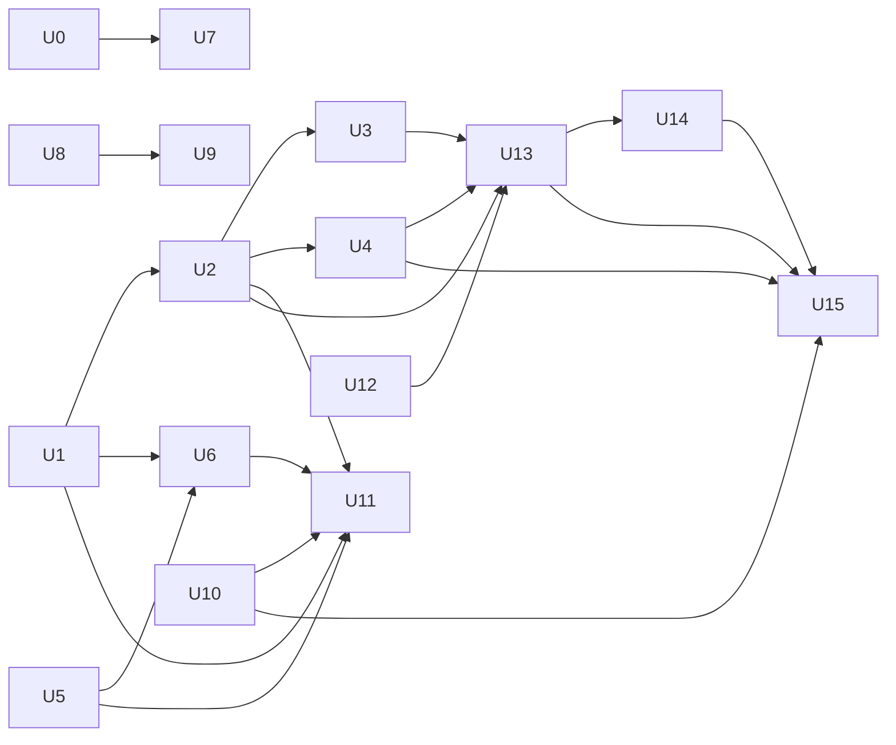

# Delivery plan: PHS-09

Deliver the [requirements](prd.md) of PHS-09 through behavior slices that can each be verified on their own. The [technical solution](solution.md) defines the mechanisms, and this plan defines their delivery order and checks. Unit U0 first corrects the [startup issues in Programmatic Control](../../../../issues/programmatic-startup-issues/solution.md), because PHS-09 adds rejected tool replacements as a new kind of startup issue.

## Key definitions and abbreviations

The [domain glossary](../../../../../terms.md) defines the run-control terms. A unit is ready when its behavior test passes, `task fmt`, `task fix_dry_run`, `task lint`, and `task check` pass after its last change, it holds no temporary code, and its reviews end without accepted findings. The [approved verification exceptions](#standards-deviations) apply to these checks.

## Delivery strategy

Units run one after another in the same working copy, because most of them change shared files: the public protobuf sources, `host/internal/usecase/agent/run/service.go` and `tool_calls.go`, `host/internal/usecase/host/tools/service.go`, the extension SDK context operations, and the application compositions in `host/internal/app`. Each unit is committed after its checks and reviews pass. The change adds no feature flag, compatibility path, or storage migration.

## Main changes

- Programmatic Control: startup-issue connection event, `steer` and `followUp` enqueue command, queue-mode command, returned client messages, tool-result category and `terminate`.
- Extension Contract and SDK: pre-execution tool-call handler, tool replacement and concurrency declarations, `terminate` in tool results, active-tool-set operations, queued delivery points of `append_extension_message`, abort of the current agent run.
- Host: tool-call handler chain, tool replacement rules at startup, active tool set, run-control acceptance of queued messages and abort requests.
- Agent Core: message queue and delivery points, concurrent tool groups, the `terminate` end condition, own cancel function of the current run.
- Reference extensions in `testdata/external-plugins`: tool policy, tool override, terminating output.

## Entities and invariants

See [D2](solution.md#d2-error-category-and-the-terminate-flag-in-tool-results) for the tool-result category and `terminate`, [D5](solution.md#d5-concurrent-tool-batches) for result order in a concurrent batch, and [D6](solution.md#d6-message-queue-in-agent-core) for the queue, delivery points, and the rules for undelivered messages.

## New folders and components

See [D9](solution.md#d9-boundaries-and-documents). The reference extensions are new commands in `testdata/external-plugins`.

## Backward compatibility

No backward compatibility.

## Plan units

| Unit | Kind | Outcome | Scenarios | Performer |
| --- | --- | --- | --- | --- |
| U0 | SLICE | A Programmatic Control client receives each startup issue | Issue verification | `workflows:developer-regular` |
| U1 | SLICE | A client sends `steer` during an agent run | SCN-13 (steer), SCN-02 (steer part) | `workflows:developer-complex` |
| U2 | SLICE | A client sends `followUp` during an agent run | SCN-13 | `workflows:developer-regular` |
| U3 | SLICE | A client selects the queue mode | SCN-14 | `workflows:developer-regular` |
| U4 | SLICE | A client gets its pending messages back after failure or abort | SCN-16 | `workflows:developer-regular` |
| U5 | SLICE | Tool error results carry a Glyph category | SCN-04, SCN-05 (category) | `workflows:developer-regular` |
| U6 | SLICE | Extensions allow, change, or reject a tool call before it runs | SCN-01, SCN-02, SCN-03 | `workflows:developer-regular` |
| U7 | SLICE | An extension replaces a tool of another extension | SCN-06, SCN-07 | `workflows:developer-regular` |
| U8 | SLICE | An extension reads the registered tools and the active tool set | SCN-08 (read) | `workflows:developer-regular` |
| U9 | SLICE | An extension sets the active tool set | SCN-08 | `workflows:developer-regular` |
| U9.1 | OTHER TASK | The existing stream-loss integration test waits for its expected SDK close invocation | Existing integration test | Main agent |
| U10 | SLICE | Calls of concurrent tools in one batch run at the same time | SCN-09 | `workflows:developer-complex` |
| U11 | SLICE | Tool results with `terminate` end the agent run | SCN-10, SCN-11, SCN-05 | `workflows:developer-regular` |
| U12 | PREFACTORING | The extension controller stops importing Agent Core | Existing tests | `workflows:developer-simple` |
| U13 | SLICE | An extension sends `steer` and `followUp` | SCN-12 (steer, followUp) | `workflows:developer-complex` |
| U14 | SLICE | An extension sends `nextTurn` | SCN-12 (nextTurn), SCN-18 | `workflows:developer-regular` |
| U15 | SLICE | An extension aborts the current agent run | SCN-15 | `workflows:developer-complex` |

### Unit tree

The edges show dependencies on results. Units without an edge between them still run one after another in the order of the table, because they change shared files.

### Decomposition justification

Each slice starts at a public entry point, a Programmatic Control command or an extension operation, and ends at an observable result: a provider request, an agent-run event, a session entry, or an operation outcome. Each slice has its own verification through its entry point. No unit adds code that exists only to make it testable.

U1 comes first among the PHS-09 units, because U2 through U4, U11, and U13 through U15 depend on the queue in Agent Core and on the queue check at the end of a run. U11 comes after U10, because SCN-10 needs one call of a batch to finish while another call still runs. U11 also verifies SCN-05 completely, because SCN-05 rewrites a policy-rejected result (U5, U6) and a terminating result. U12 comes right before U13, because U13 makes run control implement an interface of the extension controller, and the import `controller/extension` to `run` would then close the cycle `runcontrol` to `controller/extension` to `run` to `runcontrol`.

## Overengineering and overspecification considerations

The units follow the methods D1 through D9 of the technical solution and the issue solution, and add no method. Shared contract changes arrive with their first consumer. The plan leaves field names, category spellings, rejection codes, and the layout of reference extensions to the implementer, as the technical solution does.

## Unit checks

After each unit, these checks run in parallel:

- `workflows:code-quality` checks the code quality of the unit's changes against the approved technical solution; for U0, against the issue solution.
- `SubAgentAnalyst` reviews the behavior of the unit's changes against this plan, the requirements, and the technical solution for U1, U4, U6, U10, U13, U14, and U15. An error in the queue, locks, cancellation, or tool policy of these units causes severe harm after release.

When the reviews end without accepted findings, `workflows:extractor` runs `task fmt`, `task fix_dry_run`, `task lint`, and `task check`, subject to the [approved verification exceptions](#standards-deviations), and the unit is committed.

### U0 - SLICE: startup issues in Programmatic Control

#### Goal
A Programmatic Control client learns the complete text of each startup issue.

#### Behavior
The client opens its stream and receives one startup-issue connection event for each issue of extension loading, before any other event.

#### Work
New connection event in the Programmatic Control contract; the Programmatic Control composition keeps the startup report; the output adapter sends the events when the stream writer is bound. See the [issue solution](../../../../issues/programmatic-startup-issues/solution.md).

#### Verification
Own verification, in process: two extensions register the same tool name, and the client receives the conflict event with both extension IDs and the complete text.

#### Exit criteria
The test passes; the project checks pass; the issue status in `docs/specs/issues/issues.md` is updated.

#### Relation
Independent of other units.

#### Risks
An event sent before the client reads its stream could be lost. Impact: HIGH. The test reads the events through the real stream.

### U1 - SLICE: client `steer`

#### Goal
A client gives the agent a new instruction during an agent run without aborting it.

#### Behavior
The client sends a `steer` message while the agent run is active. Agent Core delivers it after the current tool batch, or after a final response without tool calls, and the next model request contains it.

#### Work
Queue of messages in Agent Core with the default mode `one-at-a-time`; run control accepts a message after the same input processing as `user_request`; a Programmatic Control enqueue command that bypasses the operation gate; delivery points after a tool batch and after a final response; the queue check and the transition to completion under the lock that `begin`, `finish`, and `Settle` use; an explicit error for an enqueue while no agent run is active. Architecture sections CMP-03 and APC-08.

#### Verification
Own verification, in process: the provider holds a model request, the client enqueues `steer`, and the next provider request contains it; after a final response, a pending `steer` causes another model request.

#### Exit criteria
SCN-13 (steer part) and the steer part of SCN-02 without a policy pass; SCN-17 holds by an import check; the project checks pass.

#### Relation
Independent of earlier units. U2, U3, U4, U6, U11, U13, U14, and U15 depend on it.

#### Risks
A message that arrives while the run ends could be lost or accepted after the run. Impact: HIGH. The queue check and the completion transition use one lock, and a test enqueues during completion.

### U2 - SLICE: client `followUp`

#### Goal
A client assigns the agent work for after the current task.

#### Behavior
The client sends a `followUp` message. Agent Core delivers it only when no tool calls and no `steer` messages remain, and the model responds to it in the same agent run.

#### Work
Second message kind in the enqueue command and in the Agent Core queue; `steer` takes precedence at the end of a run.

#### Verification
Own verification, in process: SCN-13 with both message kinds.

#### Exit criteria
SCN-13 passes; SCN-17 holds; the project checks pass.

#### Relation
Depends on U1.

#### Risks
None beyond U1.

### U3 - SLICE: queue mode

#### Goal
A client controls how many queued messages the agent receives at one delivery point.

#### Behavior
The client selects `all` or `one-at-a-time`. In `all`, the next model request contains every pending message of one kind; in `one-at-a-time`, it contains one.

#### Work
Programmatic Control command that bypasses the operation gate, as `set_retry_enabled` does; process-level mode in Agent Core for `steer` and `followUp`.

#### Verification
Own verification, in process: SCN-14 for `steer`, plus the same check for `followUp`.

#### Exit criteria
SCN-14 passes; SCN-17 holds; the project checks pass.

#### Relation
Depends on U1 and U2.

#### Risks
None beyond U1.

### U4 - SLICE: pending client messages after failure or abort

#### Goal
A user keeps the text of messages that the agent did not receive.

#### Behavior
An agent run fails or is aborted while client messages are pending. The model receives none of them, and the client receives them back in the form in which it sent them, in `agent_end` and in the agent-run summary before the operation terminal event.

#### Work
Agent Core keeps the original client message next to the processed one and discards pending `steer` and `followUp` on each failure and abort path; the run summary and the Programmatic Control summary carry the returned messages.

#### Verification
Own verification, in process: SCN-16 with a failing provider and pending messages.

#### Exit criteria
SCN-16 passes; SCN-17 holds; the project checks pass.

#### Relation
Depends on U1 and U2. U13 and U15 depend on it.

#### Risks
A failure path that skips the cleanup would deliver an old instruction in a later run. Impact: HIGH. Core tests cover provider, tool, finalization, persistence, and event-delivery failure paths.

### U5 - SLICE: tool error category

#### Goal
The model and the client tell the kinds of tool errors apart.

#### Behavior
An error result of a tool call carries a Glyph category from a closed set: unavailable tool, invalid arguments, or tool failure. The client sees the category in events, in `get_messages`, and after a restart; the model sees it in the result text. A tool-result handler that changes only the text keeps the category.

#### Work
Category in the domain tool result, the Programmatic Control result, session persistence, and the shared session-tree tool result of the Extension Contract; Host assigns the category and checks the closed set for replacements; Host adds the category to the model-visible text before model-context handlers run. Architecture section STP-07 and the finalized-message guide.

#### Verification
Own verification, in process: a call with invalid arguments shows its category to the client and to the model; a tool-result handler rewrites the text and the category stays; SCN-04 as a regression.

#### Exit criteria
SCN-04 and the category part of SCN-05 pass; the project checks pass.

#### Relation
Independent. U6 and U11 depend on it.

#### Risks
A conversion layer that drops the category hides it from one consumer. Impact: MEDIUM. Tests cover the persistence round trip and the finalized-message round trip.

### U6 - SLICE: tool policy before execution

#### Goal
An extension enforces a tool policy.

#### Behavior
Before a tool call runs, the handlers of the new kind run in registration order with the original and the current call. A handler allows the call, replaces its input, or rejects it. A rejection gives the model and the client an error result with the policy category and the complete reason, and the run continues. A handler error or an invalid action fails the run, and the tool does not run.

#### Work
New handler kind through the Extension Contract, the SDK, the runtime adapter, startup, and the middleware owner; the chain runs inside `tools.Service.Execute` and validates each replacement against the tool schema; a handler failure becomes a fatal operation failure; reference tool-policy extension. Architecture sections CMP-08 and STP-06, folder tree, and the middleware guide.

#### Verification
Own verification, in process: SCN-01, SCN-02 with a client `steer`, and SCN-03 with two real policy extensions that record their invocations.

#### Exit criteria
SCN-01, SCN-02, and SCN-03 pass; the project checks pass.

#### Relation
Depends on U1 and U5. U11 depends on it.

#### Risks
A handler failure that becomes an ordinary tool error would let an unchecked call continue. Impact: HIGH. SCN-03 checks that the tool did not run and that the run failed.

### U7 - SLICE: tool replacement

#### Goal
An extension replaces one tool of another extension, and the other tools keep working.

#### Behavior
An extension declares a replacement of a tool. The model sees and calls the replacing tool, and the other tools and handlers of both extensions stay available. When two extensions declare a replacement of the same name, Host keeps the original tool and reports the conflict to the client.

#### Work
Replacement declaration in the tool descriptor through every registration representation; conflict rules in `tools.Service`; startup removes only a rejected replacement and keeps the current behavior for ordinary conflicts; reference tool-override extension. Architecture section CMP-08 and folder tree.

#### Verification
Own verification, in process: SCN-06 with the bundled tools extension; SCN-07 with two replacing extensions, where the client receives the conflict through the U0 event.

#### Exit criteria
SCN-06 and SCN-07 pass; the project checks pass.

#### Relation
Depends on U0.

#### Risks
A replacement that keeps the original schema or owner would split description and execution. Impact: HIGH. SCN-06 checks the description in the model request and the extension that executes the call.

### U8 - SLICE: read the tools

#### Goal
An extension sees which tools exist and which of them the model sees.

#### Behavior
An extension reads the registered tools with their active state through a context operation, also during an agent run and from inside its own tool or handler.

#### Work
Context operation through the Extension Contract, the SDK, the extension controller, and `tools.Service`; ordinary context admission without the operation gate.

#### Verification
Own verification, in process: a real extension returns the read result to the client through its tool result.

#### Exit criteria
The read part of SCN-08 passes; the project checks pass.

#### Relation
Independent. U9 depends on it.

#### Risks
None identified.

### U9 - SLICE: set the active tool set

#### Goal
An extension chooses which tools the model sees.

#### Behavior
An extension sets a new active tool set. The request in progress keeps the previous set, and the next model request, including a manual compaction request, contains the new one. An unknown name rejects the whole operation. A call of an inactive tool receives the unavailable-tool result.

#### Work
Context operation; the active set in `tools.Service` in process memory, with all tools active by default.

#### Verification
Own verification, in process: SCN-08 while the provider holds a model request.

#### Exit criteria
SCN-08 passes; the project checks pass.

#### Relation
Depends on U8.

#### Risks
A retry of the same model request reads the tool snapshot of its turn, so the test must compare different turns. Impact: LOW.

### U9.1 - OTHER TASK: stream-loss test completion

#### Goal
The stream-loss integration test finishes after the SDK invokes the expected service close operation.

#### Work
Add a signal to the generated mock's existing `Close` expectation in `TestChannelStreamLossWaitsForRelease` and await that signal before returning from the test. Retain the existing assertions about Host operation release and keep production shutdown behavior unchanged.

#### Verification
Run the existing test with the race detector, then run the project checks under the approved verification exceptions. The original failure is the missing `Close` expectation observed during U10 final integration verification; isolated stress runs passed before this correction.

#### Exit criteria
The focused test, code-quality review, and project checks pass. Commit this correction separately before U10.

#### Relation
Independent of U10 implementation. U10 final verification follows this correction.

### U10 - SLICE: concurrent tool batches

#### Goal
Independent tool calls of one batch do not wait for each other.

#### Behavior
Consecutive calls of tools that declared concurrency run at the same time; any other call waits for the preceding calls and is waited for by the following ones. History and the next model request contain the results in call order. Events of each call follow its actual work.

#### Work
Concurrency declaration in the tool descriptor; groups in Agent Core; the tool-result handler chain runs per call; events reach the event dispatcher one at a time; on a fatal failure, a handler failure, or an abort, Agent Core cancels the other calls of the group, waits for them, and appends the completed results in call order; the bundled tools extension declares `read`, `grep`, `find`, and `ls` concurrent.

#### Verification
Own verification, in process: SCN-09 with a real extension whose calls wait for signals of the test, so the order of completion does not depend on timing.

#### Exit criteria
SCN-09 passes; the existing Core tests of cancellation, fatal failure, and finalization failure pass; SCN-17 holds; the project checks pass.

#### Relation
Independent. U11 and U15 depend on it.

#### Risks
Concurrent event delivery or a group that returns before its calls end would break the one-shot renderer or extension shutdown. Impact: HIGH. The race detector of `task check` and tests of group cancellation cover it.

### U11 - SLICE: `terminate`

#### Goal
The agent makes no extra model request when the tools of a batch have completed the task.

#### Behavior
When every result of a tool batch has `terminate` and no `steer` or `followUp` message is pending, the agent run ends with the completed outcome without another model request. The flag interrupts no running call. A tool-result handler that changes only the text keeps the flag.

#### Work
The flag in the Extension Contract tool result, the domain results, the Programmatic Control result, and the finalized-message payload; it is not persisted; the end decision in Agent Core; reference terminating-output extension.

#### Verification
Own verification, in process: SCN-10 with a concurrent batch, SCN-11 in both cases, and SCN-05 with a policy-rejected result and a terminating result.

#### Exit criteria
SCN-05, SCN-10, and SCN-11 pass; SCN-17 holds; the project checks pass.

#### Relation
Depends on U1, U2, U5, U6, and U10.

#### Risks
None beyond U1.

### U12 - PREFACTORING: extension controller without Agent Core import

#### Goal
The extension controller depends only on domain packages, so run control can implement its interfaces in U13.

#### Work
The extension controller declares its own interface with the `FatalOperation` method and stops importing `host/internal/usecase/agent/run`.

#### Verification
Existing tests of failure classification in the extension controller and the runtime.

#### Exit criteria
The import is removed; the project checks pass.

#### Relation
Independent. U13 depends on it.

#### Risks
None identified.

### U13 - SLICE: extension `steer` and `followUp`

#### Goal
An extension gives the agent instructions and work during an agent run.

#### Behavior
An extension calls `append_extension_message` with the `steer` or `followUp` delivery point, also from inside its own tool. The operation completes with a queued result when the queue accepts the message. Agent Core delivers the message at its delivery point, and history keeps the extension origin.

#### Work
Delivery point in `append_extension_message` and the queued result; run control implements the enqueue interface of the extension controller; Agent Core delivers through an interface that `extensioncontext` implements; Host records the extension runtime instance and the session incarnation at acceptance and checks them at delivery; binding order in the RPC, UI, and one-shot compositions.

#### Verification
Own verification, in process: the steer and followUp parts of SCN-12.

#### Exit criteria
The steer and followUp parts of SCN-12 pass; SCN-17 holds; the project checks pass.

#### Relation
Depends on U2, U3, U4, and U12. U14 and U15 depend on it.

#### Risks
A queued append that waits for delivery would deadlock a tool that sends `steer`. Impact: HIGH. The test sends `steer` from inside a running tool.

### U14 - SLICE: extension `nextTurn`

#### Goal
An extension attaches data to the next user message.

#### Behavior
An extension sends a `nextTurn` message during an agent run or between agent runs. No agent run starts. The next user message starts an agent run, and its model request contains the extension message before the user message. The message survives tree navigation, and Host discards it after a session change or an extension restart.

#### Work
Acceptance between agent runs; delivery at the start of an agent run; pending `nextTurn` messages survive failure and abort.

#### Verification
Own verification, in process: SCN-18 from a real `agent_settled` observer and the nextTurn part of SCN-12; session change through Programmatic Control session commands; extension restart through the existing runtime-generation tests, because Programmatic Control has no restart command.

#### Exit criteria
SCN-12 and SCN-18 pass; SCN-17 holds; the project checks pass.

#### Relation
Depends on U13.

#### Risks
A message delivered into another session would expose data of one session to another. Impact: HIGH. The test checks session create and resume with a pending message.

### U15 - SLICE: extension abort

#### Goal
An extension stops an agent run.

#### Behavior
An extension aborts the current agent run, also from inside its own tool. The run ends with the aborted outcome, the Programmatic Control operation ends canceled and names the extension, the client receives its pending messages back, extension `followUp` messages are discarded, and `nextTurn` messages stay.

#### Work
Context operation through the Extension Contract, the SDK, and the extension controller; run control passes the request to Agent Core; Agent Core holds its own cancel function of the current run; Programmatic Control selects the canceled state for an aborted outcome.

#### Verification
Own verification, in process: SCN-15, and an abort from inside a tool of a concurrent group.

#### Exit criteria
SCN-15 passes; SCN-17 holds; the project checks pass.

#### Relation
Depends on U4, U10, U13, and U14.

#### Risks
An abort that waits for the end of the run would deadlock the calling tool. Impact: HIGH. The test aborts from inside a running tool.

## Test strategy

Each slice has an integration test in `host/internal/app` with the `integration` build tag. The test runs Host in process, starts real extension processes built from `testdata/external-plugins`, uses a scripted model provider that records request bodies, and drives Host through a Programmatic Control client. The existing tests `TestPublicFinalizedMessages` and `TestPublicAbortReleasesAgent` show the pattern. Unit tests cover failure paths that a client cannot trigger, for example a failing event sink or history store. SCN-17 is an import check of the Agent Core packages. Each focused test fails before its unit and passes after it, as ticket NFQ-01 requires.

The whole result is then checked in the workflow stages for verification of the implementation, preliminary acceptance by the user, and review of the scenarios across all changed units and modules.

## Dependencies and resourcing

No external dependencies.

## Project definition of done

`docs/roadmap.md` shows the PHS-09 status, `docs/specs/issues/issues.md` shows the status of the startup-issue correction, and the architecture sections that D9 names describe the delivered behavior.

## Assumptions

None.

## Open questions

None.

## Standards deviations

For PHS-09 verification, omit `TestPublicFinalizedOneShot` and `TestPublicInputMiddlewareOneShot` from the integration-test shards of the `task check` procedure. These two functions contain eight scenarios that override child-process `HOME`. Run every other test and retain race detection and the 80 percent minimum for combined coverage. Report the eight omitted scenarios explicitly; a successful filtered run is not a successful unmodified `task check`. Compare warm check times using the same exclusions before and after each remaining unit. The [roadmap](../../../../../roadmap.md#one-shot-integration-tests-without-home-overrides) schedules their correction after PHS-09.

This plan predates the current TDD rules. For its remaining delivery, record deviations in test selection or RED-before-code chronology without stopping work or requesting separate approval. Continue to use TDD for new work and preserve the actual chronology of each check. For example, when a required public assertion is added after implementation, identify its earlier coverage and any missing original RED evidence. Reviews, required behavior coverage, and project checks remain mandatory.

For U10, the original RED-before-code chronology was not retained for `TestPublicConcurrentToolBatch` and the final `TestEventDeliveryIsSerialized` harness. Reconstructed RED runs establish regression sensitivity, and the completed implementations pass GREEN runs.

For U11, the developer found fitting category round-trip tests before creating separate terminate tests. The developer later consolidated those checks into the existing round trips. The developer added the public copy-and-edit path in `TestPublicTerminateBatch` after production flag propagation, so the original public-level RED chronology for that path is absent. The retained compilation RED and behavioral RED runs cover the other reported changes; they do not establish that missing chronology.

## References

- [Ticket](ticket.md) - phase scope and acceptance criteria
- [Requirements](prd.md) - FRQ-01 through FRQ-13, NRQ-01, SCN-01 through SCN-18
- [Technical solution](solution.md) - methods D1 through D9
- [Startup issues in Programmatic Control](../../../../issues/programmatic-startup-issues/solution.md) - solution of U0
